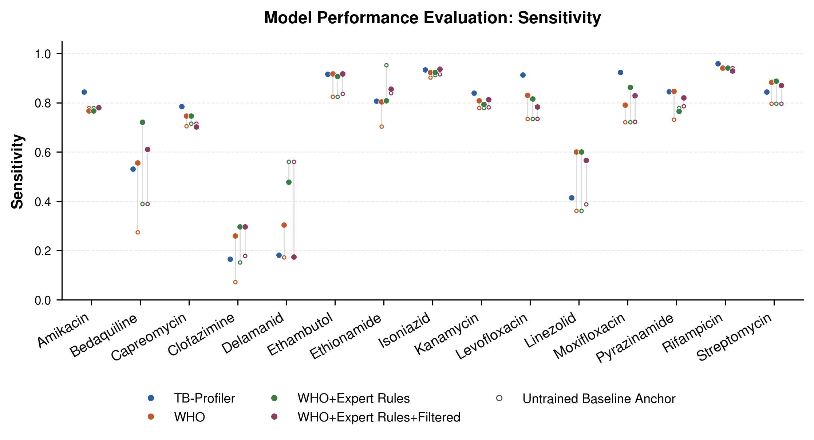

# neural-tbprof

**Neural network drug-resistance prediction for *Mycobacterium tuberculosis*, initialised from the WHO mutation catalogue.**

Catalogue-based tools like [TB-Profiler](https://github.com/jodyphelan/TBProfiler) predict resistance by looking up known mutations. They work well for first-line drugs, but miss a large share of resistance to newer drugs such as bedaquiline, clofazimine and delamanid. `neural-tbprof` keeps the catalogue as its starting point. Each drug is a single-layer neural network whose weights start at the catalogue's variant effects, and the network then learns from ~44,000 genomes with known drug susceptibility where the catalogue is wrong.

> MSc (Bioinformatics) research project, University of Melbourne, carried out at the Peter Doherty Institute for Infection and Immunity under Prof. Lachlan Coin and Dr.Michael Hall. 


---

## Why this approach

- **Keeps what the catalogue gets right.** Weights are initialised from WHO 2023 catalogue grades. An *anchored* L2 regulariser penalises drift away from those starting weights, rather than shrinking weights towards zero as standard L2 does. The model only departs from the catalogue where the data clearly supports it.
- **Interpretable by design.** Each drug is one dense layer over binary variant features, so every learned weight belongs to a specific mutation. Ablation of individual variants identifies the ones driving prediction changes.
- **Looks where standard pipelines don't.** The PE/PPE gene family (~10% of the genome) is usually masked. Here it is kept in, and a recurrent set of uncatalogued PE/PPE variants turns up across 12 drugs.

## Results


Sensitivity at a fixed specificity of ~0.80, compared with TB-Profiler, the three NN variants use WHO SNPs, WHO + expert rules, and WHO + expert rules + filtered variant sets respectively.

| Drug | TB-Profiler | WHO NN | WHO+ER NN | WHO+ER+Filt NN |
|:-----|:-----------:|:------:|:---------:|:--------------:|
| AMK | **0.844** | 0.878 | 0.881 | 0.881 |
| BDQ | **0.531** | 0.556 | 0.722 | 0.722 |
| CAP | **0.785** | 0.847 | 0.871 | 0.863 |
| CFZ | **0.166** | 0.370 | 0.296 | 0.333 |
| DLM | **0.181** | 0.304 | 0.478 | 0.478 |
| EMB | **0.916** | 0.948 | 0.950 | 0.947 |
| ETO | **0.807** | 0.851 | 0.801 | 0.841 |
| INH | **0.934** | 0.945 | 0.949 | 0.948 |
| KAN | **0.840** | 0.872 | 0.875 | 0.863 |
| LFX | **0.913** | 0.816 | 0.816 | 0.789 |
| LZD | **0.414** | 0.600 | 0.600 | 0.600 |
| MFX | **0.923** | 0.794 | 0.868 | 0.759 |
| PZA | **0.846** | 0.894 | 0.890 | 0.886 |
| RIF | **0.959** | 0.941 | 0.941 | 0.962 |
| STP | **0.844** | 0.939 | 0.926 | 0.927 |

Summary: matched or exceeded TB-Profiler sensitivity on 13–14 of 15 drugs, with the largest gains on newer drugs. Full per-drug metrics (AUC, sensitivity, specificity, F1, threshold) are in `results/metrics/*_by_drug_metrics.csv`.

## How it works

```
 ENA/SRA genomes (VCF)          WHO 2023 catalogue
         │                              │
         ▼                              ▼
 label isolates with phenotypes   catalogue → JSON, map variants to genes
         │                              │
         └──────────────┬───────────────┘
                        ▼
      sparse binary matrix  (~44,000 isolates × ~26,000 variants)
                        ▼
      per-drug weight matrix initialised from catalogue grades
                        ▼
      anchored fine-tuning (masked, class-weighted BCE; 15 drug outputs)
                        ▼
      threshold selection → per-drug metrics, ablation, figures
```

Three variant sets are compared, each passed to the scripts as an argument:

| Argument | Variant set |
|----------|-------------|
| `who` | WHO 2023 catalogue variants only |
| `er` | WHO catalogue plus expert-rule variants |
| `filt` | Expert rules, filtered to variants enriched in false-negative calls |

The `_CR` variants of each run are an attempt to incorporate WHO cross-resistance data. 

## Repository layout

```
tbml/                 Reusable library: models, losses, metrics, thresholds, plotting
  models.py           Anchored dense models (catalogue-initialised, L2-to-anchor)
  losses.py           Masked, class-weighted binary cross-entropy (handles missing phenotypes)
  metrics.py          Masked F1 / AUC across 15 drug outputs
  thresholds.py       Per-drug decision threshold selection
scripts/              Pipeline steps (run in the order below)
data/                 Small example inputs (3 VCFs, WHO catalogue sheets)
results/figures/      Summary figures
results/metrics/      Per-drug metric tables
```

## Installation

```bash
git clone https://github.com/Nabil-Islam/neural-tbprof.git
cd neural-tbprof
python -m venv .venv && source .venv/bin/activate
pip install -e .
```

Requires Python ≥ 3.9. Dependencies (TensorFlow, tf_keras, NumPy, pandas, SciPy, scikit-learn, matplotlib) are listed in `pyproject.toml`.

## Running the pipeline

Run the scripts from the repository root, in this order. `<set>` is one of `who`, `er` or `filt`.

```bash
# 1. Data preparation (run once)
python scripts/label_data.py            # attach phenotypes to each isolate's VCF
python scripts/augment_snp.py           # map catalogue variants to genes and positions
python scripts/filtered_snps.py         # build the filtered variant set

# 2. Build matrices and initial weights (per variant set)
python scripts/make_index.py <set>      # variant index and lookup table
python scripts/weights.py <set>         # catalogue-initialised weight matrix

# 3. Baseline and training
python scripts/forward_pass.py <set>    # untrained (catalogue-only) baseline
python scripts/train.py <set>           # anchored fine-tuning

# 4. Comparison and figures
python scripts/comp.py                  # compare against TB-Profiler
python scripts/plot.py
```

On a SLURM cluster, `shell.sh` runs training for all three variant sets.

> **Full dataset:** the complete ~44,000-genome input isn't included because of its size. Genomes are public on ENA/SRA (accessions in `results/essentials/vcf_list.txt`), and the catalogue is the [WHO 2023 mutation catalogue](https://www.who.int/publications/i/item/9789240082410). `data/` contains three example VCFs for testing.

## Data sources

- **Genomes:** public *M. tuberculosis* sequencing data from ENA/SRA, variant-called and profiled with TB-Profiler.
- **Phenotypes:** [source of phenotypic drug-susceptibility data].
- **Catalogue:** WHO *Catalogue of mutations in Mycobacterium tuberculosis complex and their association with drug resistance*, 2nd edition (2023).

## Citation

A manuscript is in preparation. Until then, please cite this repository:

> Islam N, [co-authors]. *neural-tbprof: catalogue-initialised neural networks for M. tuberculosis drug-resistance prediction.* GitHub, 2026.

## Licence


## Contact

Nabil Islam · nabil8976@gmail.com
